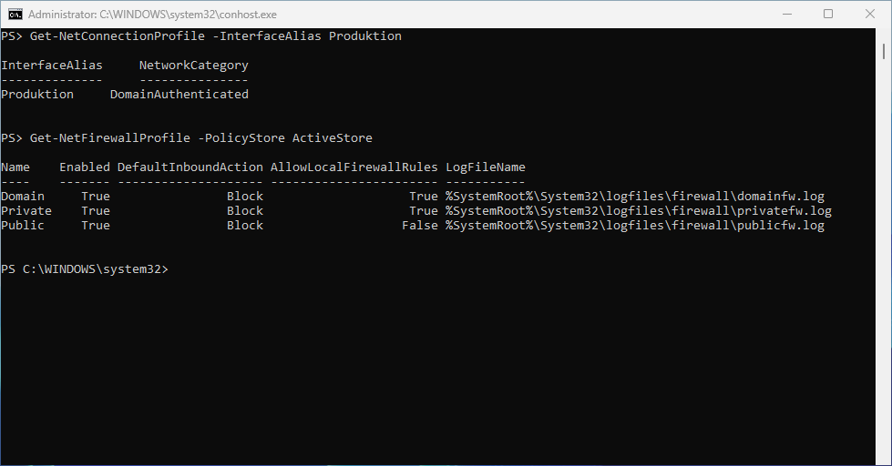

# Härdning: Windows-brandväggen på SRV-01-DC

Konfigurera Windows-brandväggen på SRV-01-DC enligt CIS Microsoft Windows Server 2025 Benchmark v2.1.0, avsnitt 9 (Level 1 – Domain Controller), och enligt minsta rättighet (least privilege): all inkommande trafik blockeras som standard, reglerna släpper bara in trafik från produktionsnätet, och regler som en domänkontrollant inte behöver stängs av.

**Förutsättningar:** SRV-01-DC är domänkontrollant för `sost.local` och kör AD DS, DNS och DHCP ([IP-adressplanen](../../reference/ip-plan.md)). Du är inloggad som domänadministratör och kör PowerShell som administratör. Ta en snapshot eller backup av servern innan du börjar.

SRV-01-DC behöver ta emot:

| Trafik | Port | Från | Varför |
|---|---|---|---|
| DNS | 53/tcp, 53/udp | Produktionsnätet 192.168.50.0/24 | Namnuppslag |
| Kerberos | 88 och 464, tcp och udp | Produktionsnätet | Inloggning och byte av lösenord |
| Tid (NTP) | 123/udp | Produktionsnätet | Datorerna hämtar tiden från DC:n, och Kerberos kräver rätt tid |
| RPC | 135/tcp och dynamiska portar | Produktionsnätet | AD, replikering av SYSVOL, WMI |
| LDAP | 389/tcp, 389/udp, 636/tcp | Produktionsnätet | Katalogtjänsten |
| Global Catalog | 3268/tcp, 3269/tcp | Produktionsnätet | Sökning i hela katalogen |
| SMB3 | 445/tcp | Produktionsnätet | SYSVOL och NETLOGON, där datorerna hämtar grupprinciper |
| RDP | 3389/tcp | Produktionsnätet | Fjärrskrivbord för administration |
| WinRM | 5985/tcp | Produktionsnätet | Fjärrstyrning med PowerShell |
| ADWS | 9389/tcp | Produktionsnätet | AD-modulen i PowerShell |
| DHCP | 67/udp | Alla | Klienter som ännu inte har någon IP-adress |

RDP och WinRM är öppna för hela produktionsnätet, även klienternas DHCP-pool (192.168.50.100–254). Bara administratörer får logga in med fjärrskrivbord (CIS 2.2.9 i [Least Privilege](../../reference/least-privilege.md)).

NetBIOS (137/udp och 139/tcp) och Print Spooler stängs. SMB går över port 445. AD:s egen regel för 138/udp finns kvar, begränsad till produktionsnätet.

Profilernas inställningar ligger i en GPO. Begränsningen av reglerna görs lokalt på servern, så steg 4 och 5 måste göras igen om servern installeras om. GPO:n gäller alla domänkontrollanter i OU:n Domain Controllers. Miljön har bara SRV-01-DC. Tillkommer fler måste steg 4 och 5 göras även på dem.

## 1. Spara nuvarande inställningar

```
New-Item -ItemType Directory -Force C:\brandvagg
netsh advfirewall export C:\brandvagg\fore.wfw
```

Exporten innehåller de lokala reglerna, men inte GPO:n i steg 3.

## 2. Skapa mappen för loggarna

Brandväggen skapar inte mappen för loggfilerna själv. Utan mappen skrivs ingen logg, fast loggningen är påslagen. På SRV-01-DC fanns mappen inte.

```
$d = "$env:SystemRoot\System32\LogFiles\Firewall"
New-Item -ItemType Directory -Force $d
icacls $d /grant 'NT SERVICE\mpssvc:(OI)(CI)M'
```

`NT SERVICE\mpssvc` är brandväggstjänstens egen identitet (tjänst-SID). Den måste kunna skriva i mappen.

## 3. Ställ in profilerna med en GPO (CIS 9.1–9.3)

GPO:n heter `CIS - Windows Firewall DC` och länkas till OU:n Domain Controllers. Alla tre profilerna får samma värden, utom två inställningar som bara finns för Public:

| Inställning | Värde | Domain | Private | Public |
|---|---|---|---|---|
| Firewall state | On (recommended) | 9.1.1 | 9.2.1 | 9.3.1 |
| Inbound connections | Block (default) | 9.1.2 | 9.2.2 | 9.3.2 |
| Settings: Display a notification | No | 9.1.3 | 9.2.3 | 9.3.3 |
| Settings: Apply local firewall rules | No | – | – | 9.3.4 |
| Settings: Apply local connection security rules | No | – | – | 9.3.5 |
| Logging: Name | `%SystemRoot%\System32\logfiles\firewall\<profil>fw.log` | 9.1.4 | 9.2.4 | 9.3.6 |
| Logging: Size limit (KB) | 16 384 | 9.1.5 | 9.2.5 | 9.3.7 |
| Logging: Log dropped packets | Yes | 9.1.6 | 9.2.6 | 9.3.8 |
| Logging: Log successful connections | Yes | 9.1.7 | 9.2.7 | 9.3.9 |

`<profil>` är `domain`, `private` eller `public`, så att varje profil får en egen loggfil. CIS kräver bara att ett namn är angivet och att storleken är minst 16 384 KB.

I Group Policy Management finns inställningarna under Computer Configuration → Policies → Windows Settings → Security Settings → Windows Defender Firewall with Advanced Security → Windows Defender Firewall with Advanced Security → Windows Defender Firewall Properties, på flikarna Domain Profile, Private Profile och Public Profile.

Med PowerShell skapas GPO:n och ställs in först. Den länkas sist, så att servern aldrig får en halvfärdig GPO:

```
$gpo = 'CIS - Windows Firewall DC'
New-GPO -Name $gpo
$s = Open-NetGPO -PolicyStore "sost.local\$gpo"
foreach ($p in 'Domain', 'Private', 'Public') {
    Set-NetFirewallProfile -GPOSession $s -Name $p -Enabled True -DefaultInboundAction Block -NotifyOnListen False `
        -LogFileName "%SystemRoot%\System32\logfiles\firewall\$($p.ToLower())fw.log" -LogMaxSizeKilobytes 16384 `
        -LogBlocked True -LogAllowed True
}
Set-NetFirewallProfile -GPOSession $s -Name Public -AllowLocalFirewallRules False -AllowLocalIPsecRules False
Save-NetGPO -GPOSession $s
New-GPLink -Name $gpo -Target 'OU=Domain Controllers,DC=sost,DC=local'
gpupdate /target:computer /force
```

**Public-profilen (9.3.4):** på ett nät av typen Public använder brandväggen bara regler från GPO:er. Ingen GPO i `sost.local` har brandväggsregler, och reglerna för AD är lokala, så då blockeras all inkommande trafik. Normalt är nätverkskortet `DomainAuthenticated`. När servern startar är det Public en kort stund. Efter en omstart av SRV-01-DC tog det 42 sekunder. Om kortet stannar på Public, se [Felsökning](#felsökning).

## 4. Begränsa reglerna till produktionsnätet

De inbyggda reglerna släpper in trafik från alla adresser. Begränsa dem till produktionsnätet:

```
$grupper = 'Active Directory Domain Services', 'Kerberos Key Distribution Center', 'DNS Service',
    'File and Printer Sharing (Restrictive)', 'DFS Replication', 'DFS Management', 'File Replication',
    'Microsoft Key Distribution Service (RPC)', 'Microsoft Key Distribution Service (RPC EPMAP)',
    'Windows Management Instrumentation (WMI)', 'File Server Remote Management', 'DHCP Server Management',
    'Active Directory Web Services', 'Windows Backup', 'Remote Desktop', 'Windows Remote Management'
foreach ($g in $grupper) {
    $r = @(Get-NetFirewallRule -DisplayGroup $g -Direction Inbound -ErrorAction SilentlyContinue)
    if ($r.Count) { $r | Set-NetFirewallRule -RemoteAddress 192.168.50.0/24 }
    '{0,3}  {1}' -f $r.Count, $g
}
```

Varje grupp ska ha minst en regel. Gruppnamnen gäller engelsk Windows Server. Står det 0 framför en grupp är namnet fel.

Två grupper ändras inte:
- **DHCP Server**: en klient som ber om en adress har ingen adress i produktionsnätet än.
- **Core Networking**: grundläggande nätverk, till exempel ICMPv6 och DHCP-klienten.

## 5. Stäng av regler som en domänkontrollant inte behöver

```
$grupper = 'File and Printer Sharing', 'Cast to Device functionality', 'AllJoyn Router', 'Wireless Display',
    'DIAL protocol server', 'WLAN Service - WFD Services Kernel Mode Driver Rules',
    'WLAN Service - WFD Application Services Platform Coordination Protocol (Uses UDP)',
    'Microsoft Media Foundation Network Source', 'mDNS', 'Delivery Optimization', 'Microsoft Edge',
    'Microsoft Edge WebView2 Runtime', 'Windows Feature Experience Pack', 'Start', 'Your account',
    'Work or school account', 'Windows Shell Experience', 'App Installer', 'Desktop App Web Viewer', 'Windows Security'
foreach ($g in $grupper) {
    $r = @(Get-NetFirewallRule -DisplayGroup $g -Direction Inbound -ErrorAction SilentlyContinue)
    if ($r.Count) { $r | Disable-NetFirewallRule }
    '{0,3}  {1}' -f $r.Count, $g
}
Get-NetFirewallRule -DisplayName 'Remote Desktop - Shadow (TCP-In)' | Disable-NetFirewallRule
Get-NetFirewallRule -DisplayGroup 'File and Printer Sharing (Restrictive)' -Direction Inbound |
    Where-Object DisplayName -match 'Spooler|LLMNR' | Disable-NetFirewallRule
Get-NetFirewallApplicationFilter | Where-Object Program -match 'WindowsBackupClient\.exe|OobeHostApp\.exe' |
    Get-NetFirewallRule | Where-Object Direction -eq 'Inbound' | Disable-NetFirewallRule
```

- **File and Printer Sharing** är den gamla gruppen med NetBIOS (137–139) och Print Spooler. SMB på port 445 finns kvar i gruppen File and Printer Sharing (Restrictive).
- **Spooler och LLMNR** i File and Printer Sharing (Restrictive): en domänkontrollant ska inte dela ut skrivare, och namnuppslag sker med DNS.
- **Remote Desktop - Shadow** låter en administratör se och styra någon annans session.
- **Port 7000** öppnas av programmen WindowsBackupClient.exe (appen Windows Backup) och OobeHostApp.exe (installationsguiden). Den används inte av Windows Server Backup.
- Övriga grupper gäller funktioner för skrivbord och media, som Cast, Wireless Display, Edge och Start, som en server inte använder.

Efter en omstart var Public-varianterna av fyra regler påslagna igen: tre för Spooler och LLMNR-UDP-In. De påverkar inget, eftersom Public-profilen inte använder lokala regler (9.3.4). Tjänsten Print Spooler (CIS 5.1) och LLMNR (CIS 18.6.4.4) stängs av i [härdningen av tjänster (#49)](https://github.com/Labontese/infra-sstab/issues/49).

## 6. Verifiera

Nätverkskorten ska ha `NetworkCategory : DomainAuthenticated`:
```
Get-NetConnectionProfile
```

Alla profiler ska ha `Enabled True`, `Block` och en egen loggfil. Public ska ha `AllowLocalFirewallRules False`:
```
Get-NetFirewallProfile -PolicyStore ActiveStore |
    Format-Table Name, Enabled, DefaultInboundAction, AllowLocalFirewallRules, LogFileName
```



`CIS - Windows Firewall DC` ska stå under *Applied Group Policy Objects*:
```
gpresult /r /scope computer
```

Bara Core Networking och DHCP Server ska släppa in trafik från alla adresser:
```
Get-NetFirewallRule -PolicyStore ActiveStore -Direction Inbound -Enabled True -Action Allow |
    Where-Object { ($_ | Get-NetFirewallAddressFilter).RemoteAddress -contains 'Any' } |
    Group-Object DisplayGroup | Select-Object Count, Name
```

Testa portarna från SRV-02-LNX, som finns i produktionsnätet. Alla ska vara öppna utom 139:
```
for p in 53 88 135 139 389 445 464 636 3268 3389 5985 9389; do
  timeout 3 bash -c "</dev/tcp/192.168.50.10/$p" 2>/dev/null && echo "$p öppen" || echo "$p stängd"
done
```

Blockerade anslutningar loggas med ordet `DROP`. Loggen skrivs i omgångar, så det kan ta en stund innan nya rader syns:
```
Select-String -Path "$env:SystemRoot\System32\LogFiles\Firewall\domainfw.log" -Pattern ' DROP ' | Select-Object -Last 5
```

Kontrollera till sist att AD fungerar:
```
dcdiag /q
```

Efter en omstart kan testet SystemLog visa händelser från uppstarten, till exempel att DHCP inte hittade någon katalogserver. De fanns på SRV-01-DC redan före ändringen.

## Felsökning

**Nätverkskortet är Public.** Då blockeras all inkommande trafik, även AD och fjärrskrivbord, och servern nås bara via konsolen (iDRAC, 192.168.99.10). Kontrollera att kortets DNS-server är 192.168.50.10 och starta om tjänsten Network Location Awareness:
```
Restart-Service NlaSvc -Force
```

**Loggfilerna saknas.** Kontrollera att mappen från steg 2 finns och att `NT SERVICE\mpssvc` har rätten `M` i den (`icacls $env:SystemRoot\System32\LogFiles\Firewall`). På SRV-01-DC skapades mappen efter steg 3, och loggfilerna kom först när samma loggvärden också sattes lokalt. GPO:n går före de lokala värdena, så de ändrar inget annat:
```
foreach ($p in 'Domain', 'Private', 'Public') {
    Set-NetFirewallProfile -Name $p -LogFileName "%SystemRoot%\System32\logfiles\firewall\$($p.ToLower())fw.log" `
        -LogMaxSizeKilobytes 16384 -LogBlocked True -LogAllowed True
}
```

## Ångra

Ta bort länken till GPO:n och läs in de sparade lokala reglerna:
```
Remove-GPLink -Name 'CIS - Windows Firewall DC' -Target 'OU=Domain Controllers,DC=sost,DC=local'
gpupdate /target:computer /force
netsh advfirewall import C:\brandvagg\fore.wfw
```

## Resultat

SRV-01-DC 2026-11-23, före och efter en omstart:
- Alla 23 inställningar i CIS 9.1–9.3 finns i registret med de värden CIS anger.
- Bara Core Networking (14 regler) och DHCP Server (4) släpper in trafik från alla adresser. Före ändringen gjorde de flesta av de 153 påslagna reglerna det.
- Från SRV-02-LNX i produktionsnätet var 53, 88, 135, 389, 445, 464, 636, 3268, 3389, 5985 och 9389 öppna. 139 (NetBIOS) och Spoolers port var stängda. Före ändringen var alla öppna. DNS svarade, även på SRV-posten för LDAP.
- Från en dator utanför produktionsnätet var 53, 88, 135, 139, 389, 445, 5985, 9389 och Spoolers port stängda.
- Efter omstarten var nätverkskorten Public i 42 sekunder. Under den tiden blockerades 14 paket, de flesta mDNS och NetBIOS.
- `domainfw.log` loggade blockerade anslutningar, till exempel mot port 139 från SRV-02-LNX. Loggarna kom igång efter steget under [Felsökning](#felsökning) och fanns kvar efter omstarten.
- `dcdiag /q` visade bara händelser från uppstarten, samma som före ändringen.

Från en Windows 11-klient i produktionsnätet 2026-11-25:
- Klienten fick sin adress från DHCP på SRV-01-DC och anslöts till domänen. Nätverkskortet blev `DomainAuthenticated`.
- DNS, DC-lokaliseringen (CLDAP, 389/udp), den säkra kanalen och tiden (123/udp) fungerade.
- Grupprinciperna hämtades från SRV-01-DC, och klienten fick Kerberos-biljetter för LDAP, SMB och Netlogon.
- En användare i `gg-lager` kunde logga in, skriva i Lager och läsa Gemensamma dokument, men nekades Ekonomi och att skriva i Gemensamma dokument. Nekandena kom från behörigheterna, inte från brandväggen.
- Samma portar som från SRV-02-LNX var öppna, och 139 och Spoolers port var stängda.
- `domainfw.log` blockerade inget som klienten behövde. Det som blockerades var 139, Spoolers port, NetBIOS-namnfrågor (137/udp) och LLMNR (5355/udp).

## Inte verifierat

Kerberos över udp är inte provat, eftersom klienten använde 88/tcp. Felsökningen av ett nätverkskort som stannar på Public och stegen under Ångra är inte heller provade.
