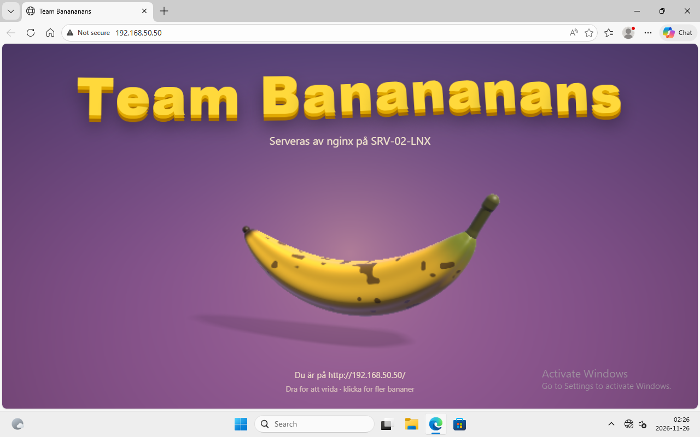

# How-to: Startsidan i Edge på klienterna med en GPO

Klienterna i domänen får [startsidan](../../web/index.html) på SRV-02-LNX som startsida i Edge, och Edge öppnas med den när någon loggar in. Inställningarna ligger i en GPO som är länkad till OU:n `Datorer`, så de gäller alla klienter som ansluts till domänen.

Alla steg finns också som skript: [`startsida.ps1`](../../scripts/windows/startsida.ps1).

**Förutsättningar:** Klienterna ligger i OU:n `Datorer` enligt [OU.md](../reference/OU.md). nginx på SRV-02-LNX visar startsidan på `http://192.168.50.50/`, och port 80 är öppen från produktionsnätet ([IP-adressplanen](../reference/ip-plan.md)). Du är domänadministratör på SRV-01-DC.

## 1. Skapa GPO:n

1. Öppna **Group Policy Management**.
2. Gå till **Forest → Domains → sost.local → SkamtSidoTransport → Datorer**.
3. Högerklicka på **Datorer** och välj **Create a GPO in this domain, and Link it here**.
4. Ange namnet `Klienter - Startsida` och klicka på **OK**.

## 2. Ställ in startsidan i Edge

Edges mallar för grupprinciper finns inte på SRV-01-DC från början, så Edges inställningar sätts med PowerShell. Värdena hamnar under `HKLM\Software\Policies\Microsoft\Edge` på klienterna:

| Värde | Inställning | Varför |
|---|---|---|
| `HomepageLocation` | `http://192.168.50.50/` | Startsidan |
| `HomepageIsNewTabPage` | 0 | Hemknappen öppnar startsidan, inte en ny flik |
| `ShowHomeButton` | 1 | Hemknappen visas |
| `RestoreOnStartup` | 4 | Edge öppnar adressen i `RestoreOnStartupURLs` när den startar |
| `RestoreOnStartupURLs\1` | `http://192.168.50.50/` | Adressen som öppnas |
| `HideFirstRunExperience` | 1 | Ingen välkomstguide första gången en användare startar Edge |
| `TranslateEnabled` | 0 | Edge frågar inte om sidan ska översättas från svenska |
| `StartupBoostEnabled` | 0 | Edge startar inte i bakgrunden vid inloggning. Annars tar bakgrundsprocessen över starten i steg 3, och inget fönster visas |

Varje rad sätts med samma kommando, med typen `String` för adresserna och `DWord` för siffrorna:

```powershell
Set-GPRegistryValue -Name 'Klienter - Startsida' -Key 'HKLM\Software\Policies\Microsoft\Edge' `
    -ValueName HomepageLocation -Type String -Value 'http://192.168.50.50/'
```

## 3. Öppna Edge när någon loggar in

1. Högerklicka på `Klienter - Startsida` och välj **Edit**.
2. Gå till **Computer Configuration → Policies → Administrative Templates → System → Logon**.
3. Dubbelklicka på **Run these programs at user logon** och välj **Enabled**.
4. Klicka på **Show…** och lägg till:
   ```text
   "C:\Program Files (x86)\Microsoft\Edge\Application\msedge.exe" http://192.168.50.50/
   ```
5. Klicka på **OK** två gånger.

## 4. Tillämpa och kontrollera

Kör på en klient:

```powershell
gpupdate /force
gpresult /r /scope computer
```

`Klienter - Startsida` ska stå under **Applied Group Policy Objects**. Logga ut och in igen. Edge ska öppnas med startsidan och visa en hemknapp. Edge öppnas bara vid en ny inloggning, inte när en låst dator låses upp.



## Ångra

Ta bort GPO:n. Inställningarna försvinner från klienterna vid nästa uppdatering av grupprinciperna, eftersom alla ligger under policynycklarna:

```powershell
Remove-GPO -Name 'Klienter - Startsida'
```

## Resultat

Från en Windows 11-klient i produktionsnätet 2026-11-26:
- `gpresult` visade `Klienter - Startsida`, och alla värden i tabellen fanns i klientens register.
- Efter en ny inloggning öppnades Edge med startsidan, med hemknapp och utan välkomstguide eller fråga om översättning.
