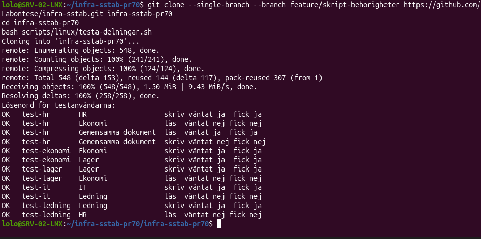

# How-to: Testa fildelning från Linux

Använd `testa-delningar.sh` för att kontrollera behörigheterna till Windows-delningarna på `SRV-01-DC`. I labbet kördes skriptet från `SRV-02-LNX`.

**Förutsättningar** – Linuxdatorn ska kunna nå `SRV-01-DC`. Kontona `test-hr`, `test-ekonomi`, `test-lager`, `test-it` och `test-ledning` ska ha rätt gruppmedlemskap och samma labblösenord. Se [OU-guiden](../reference/OU.md) för gruppkopplingarna.

## Hämta skriptet

Hämta branchen som användes i labbtestet. [Visa den testade versionen av skriptet](https://github.com/Labontese/infra-sstab/blob/055edb5e120676e492441ce7377e7cd17773c476/scripts/linux/testa-delningar.sh)

```bash
git clone --single-branch --branch feature/skript-behorigheter \
    https://github.com/Labontese/infra-sstab.git infra-sstab-pr70
cd infra-sstab-pr70
```

## Kör skriptet

Installera `smbclient` vid behov med `sudo apt install smbclient`. Kör sedan skriptet från repots huvudmapp och ange labblösenordet när du blir ombedd.

```bash
bash scripts/linux/testa-delningar.sh
```

## Läs resultatet

`OK` betyder att testet gav förväntat resultat. Raden `läs väntat nej fick nej` är godkänd eftersom kontot ska nekas läsåtkomst. `FEL` betyder att resultatet avvek från det förväntade.

Vid labbtestet visade alla 12 kontroller `OK`. Se [behörighetsmatrisen](../reference/acl/acc-plan.md) för vilka rättigheter varje grupp ska ha.

