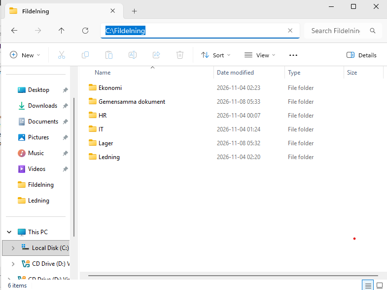
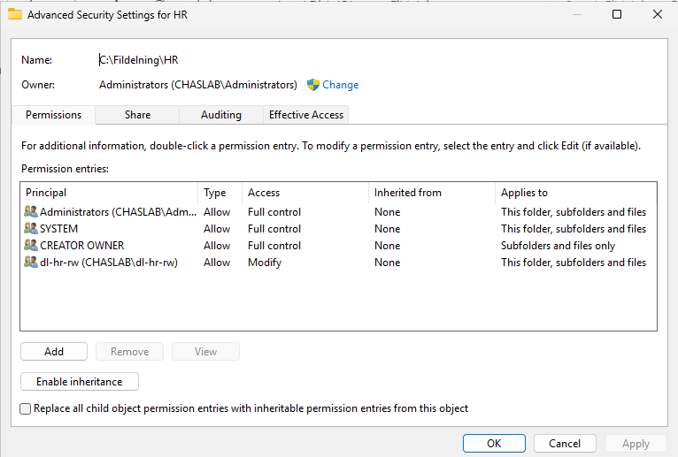
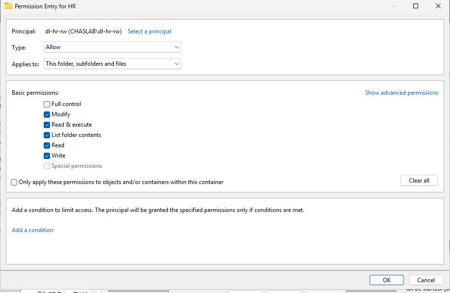
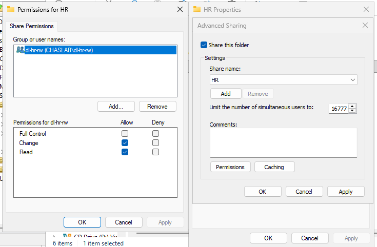
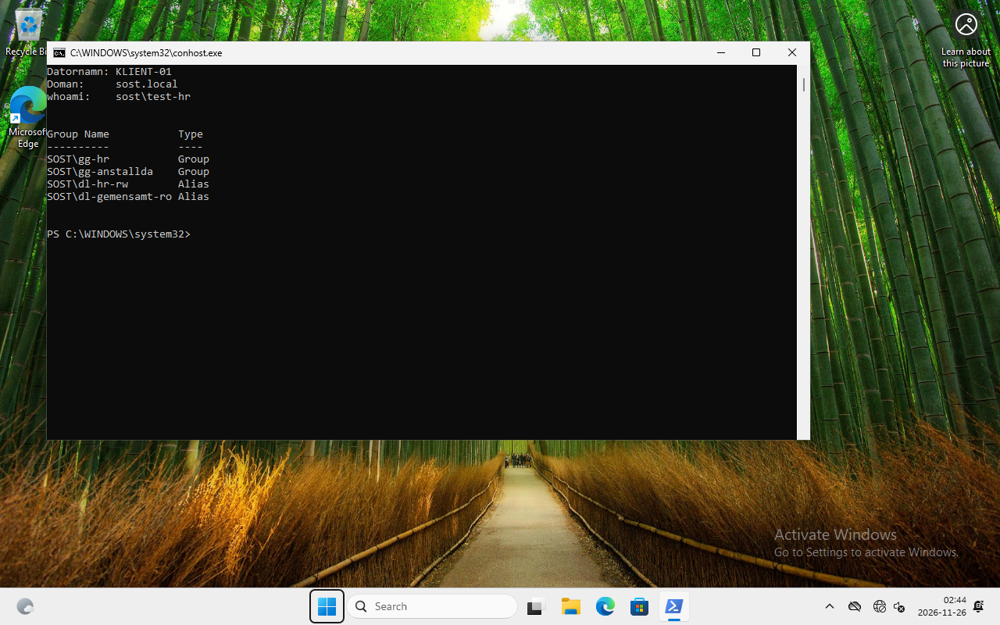
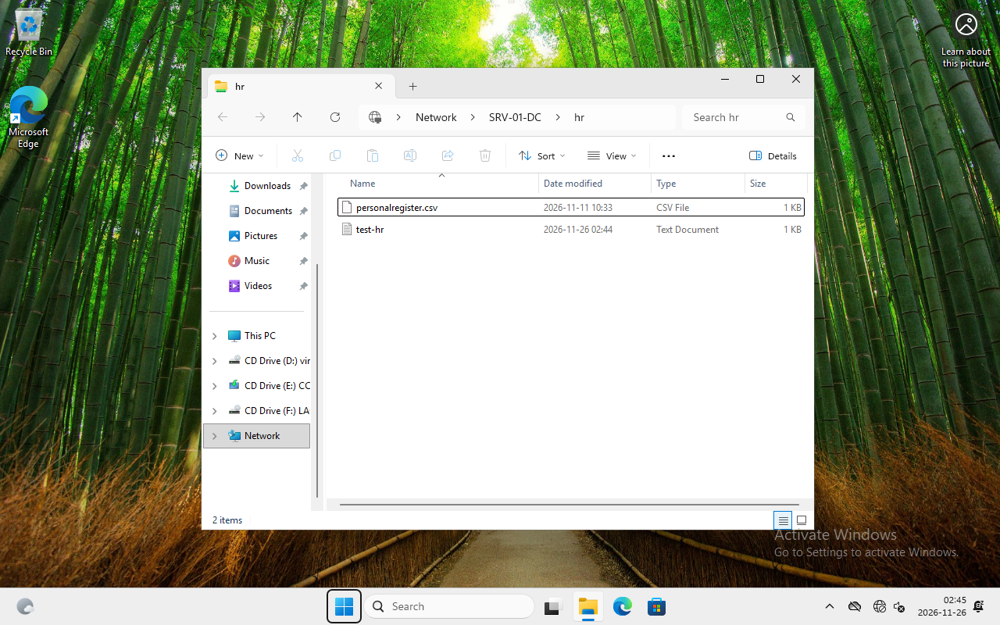
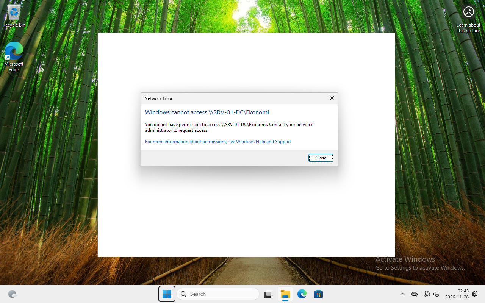
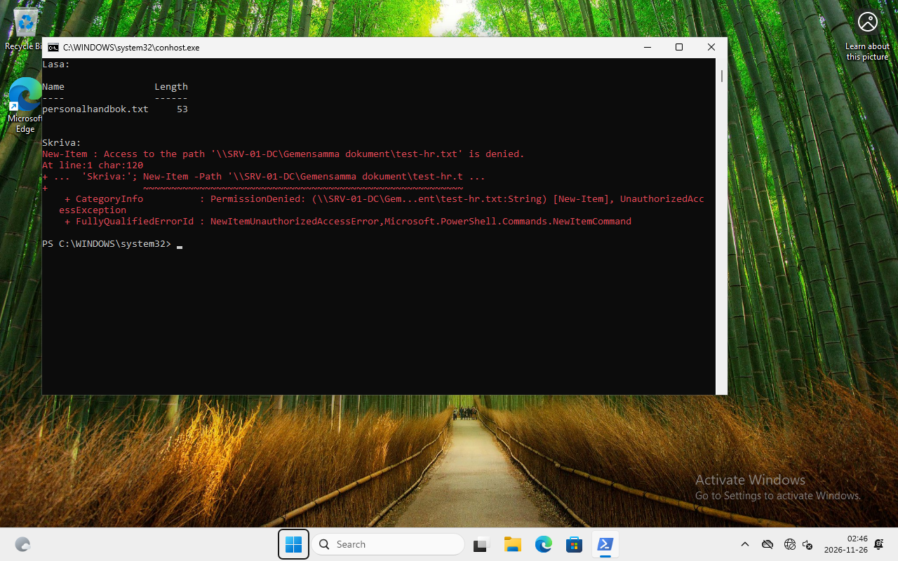
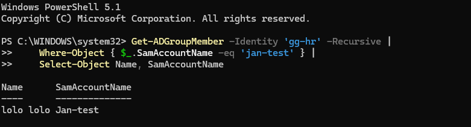
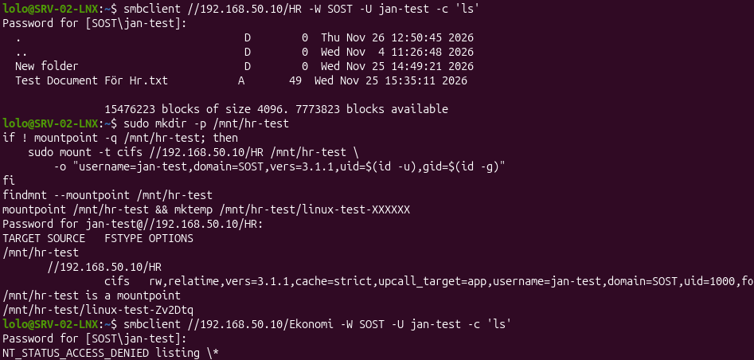

# Windows Server – Fildelning och behörigheter

Konfigurationen bygger på principen Least Privilege, där användarna bara ska ha tillgång till de resurser som behövs för deras arbete.

## Steg 1 – Skapa mappar för fildelning

En huvudmapp skapas på Windows Server för att samla avdelningarnas dokument.

### Genomförande

1. Öppna **File Explorer** på Windows Server.
2. Gå till `C:\`.
3. Högerklicka och välj **New → Folder**.
4. Namnge mappen `Fildelning`.
5. Öppna mappen.
6. Skapa en undermapp för varje avdelning samt en mapp för gemensamma dokument.

### Mappstruktur



## Steg 2 – Konfigurera NTFS-behörigheter

NTFS-behörigheter används för att bestämma vilka användare som får läsa, skapa, redigera och ta bort filer.

### Genomförande

1. Högerklicka på exempelvis `C:\Fildelning\HR`.
2. Välj **Properties**.
3. Öppna fliken **Security**.
4. Klicka på **Advanced**.
5. Klicka på **Disable inheritance**.
6. Välj **Convert inherited permissions into explicit permissions on this object**.
7. Markera `Users` och klicka på **Remove**.
8. Ta bort eventuella andra generella användarbehörigheter som ger oönskad åtkomst.
9. Behåll `SYSTEM`, `Administrators` och `CREATOR OWNER`.

10. Klicka på **Add → Select a principal**.
11. Ange `dl-hr-rw`.
12. Klicka på **Check Names → OK**.
13. Markera **Modify**.
14. Kontrollera att **Applies to** är `This folder, subfolders and files`.
15. Klicka på **OK → Apply**.



Samma steg används för övriga avdelningar med respektive säkerhetsgrupp.

### NTFS-behörigheter

| Mapp | Säkerhetsgrupp | Behörighet |
|---|---|---|
| HR | `dl-hr-rw` | Modify |
| Ledning | `dl-ledning-rw` | Modify |
| Ekonomi | `dl-ekonomi-rw` | Modify |
| Lager | `dl-lager-rw` | Modify |
| IT | `dl-it-rw` | Modify |
| Gemensamma dokument | `dl-gemensamt-ro` | Read & execute |


## Steg 3 – Dela mapparna i nätverket

Efter att NTFS-behörigheterna har konfigurerats delas mapparna ut via SMB.

### Genomförande

1. Högerklicka på exempelvis mappen `HR`.
2. Välj **Properties**.
3. Öppna fliken **Sharing**.
4. Klicka på **Advanced Sharing**.
5. Markera **Share this folder**.
6. Ange `HR` under **Share name**.
7. Klicka på **Permissions**.
8. Markera `Everyone` och klicka på **Remove**.
9. Klicka på **Add**.
10. Ange `dl-hr-rw`.
11. Klicka på **Check Names → OK**.
12. Markera **Allow → Change** och **Read**.
13. Klicka på **Apply → OK**.


Samma metod används för övriga avdelningsmappar.

### Delningsbehörigheter

| Delning | Säkerhetsgrupp | Behörighet |
|---|---|---|
| HR | `dl-hr-rw` | Change, Read |
| Ledning | `dl-ledning-rw` | Change, Read |
| Ekonomi | `dl-ekonomi-rw` | Change, Read |
| Lager | `dl-lager-rw` | Change, Read |
| IT | `dl-it-rw` | Change, Read |
| Gemensamma dokument | `dl-gemensamt-ro` | Read |


## Steg 4 – Ansluta Windows-klienten till domänen

Windows-klienten ansluts till Active Directory-domänen för att kunna använda domänens användarkonton.

### Genomförande

1. Starta Windows-klienten.
2. Tryck **Win + R**.
3. Skriv `sysdm.cpl` och tryck **Enter**.
4. Öppna fliken **Computer Name**.
5. Klicka på **Change**.
6. Välj **Domain**.
7. Ange `sost.local`.
8. Klicka på **OK**.
9. Ange administratörsuppgifter för domänen.
10. Starta om datorn.

Efter omstarten är klienten ansluten till domänen.

## Steg 5 – Testa inloggning med användarkonto

Inloggning på Windows-klienten testades med ett användarkonto från Active Directory.

### Genomförande

1. Starta Windows-klienten.
2. Öppna inloggningsskärmen.
3. Välj **Other user** vid behov.
4. Ange ett användarkonto från domänen, exempelvis `SOST\test-hr`.
5. Ange kontots lösenord.
6. Tryck på **Enter**.

### Resultat

Det visar att Windows-klienten kunde autentisera användaren mot domänen `sost.local`.

För att kontrollera vilket konto som är inloggat använde vi kommandot `whoami` i Powershell. `whoami /groups` visar att användaren är med i sin avdelningsgrupp, `gg-anstallda` och de domänlokala grupperna för HR och Gemensamt.




## Steg 6 – Kontrollera åtkomst till delade mappar

Delade mappar kan öppnas från Windows-klienten genom att ange serverns nätverkssökväg.

### Genomförande

1. Logga in på Windows-klienten med ett användarkonto från rätt avdelning.
2. Tryck **Win + R**.
3. Ange exempelvis:

```text
\\SRV-01-DC\HR
```

4. Tryck på **Enter**.
5. Kontrollera att mappen går att öppna.
6. Försök skapa ett nytt textdokument.
7. Öppna dokumentet, skriv text och spara.

### Förväntat resultat

En användare i HR-gruppen ska kunna skapa, läsa och ändra dokument i HR-mappen.


HR-användaren ska kunna öppna sin egen HR-mapp och läsa
Gemensamma dokument, men nekas åtkomst till övriga
avdelningars mappar.


### Kontrollera Gemensamma dokument

1. Tryck **Win + R**.
2. Ange:

```text
\\SRV-01-DC\Gemensamma dokument
```

3. Tryck på **Enter**.
4. Kontrollera att dokumenten går att öppna.
5. Försök skapa ett nytt textdokument.


En vanlig anställd ska kunna läsa dokumenten men inte skapa, ändra eller ta bort filer i mappen.



## Steg 7 – Kontrollera åtkomst till delade mappar från Linux

Delade mappar kan även öppnas från Linux. Vid testet användes `SRV-02-LNX` som SMB-klient mot Windowsservern `SRV-01-DC`. Anslutningen gjordes med domänkontot `SOST\Jan-test`. Se [IP-planen](ip-plan.md) för serverns adress.

### Genomförande

1. Öppna PowerShell på `SRV-01-DC`.
2. Kontrollera att `Jan-test` ingår i HR-gruppen `gg-hr`.

```powershell
Get-ADGroupMember -Identity 'gg-hr' -Recursive |
    Where-Object { $_.SamAccountName -eq 'jan-test' } |
    Select-Object Name, SamAccountName
```

3. Öppna terminalen på `SRV-02-LNX`. Installera `smbclient` och `cifs-utils` vid behov.
4. Montera HR-delningen. Ange lösenordet för `Jan-test` när du blir ombedd.

```bash
sudo mkdir -p /mnt/hr-test
sudo mount -t cifs //192.168.50.10/HR /mnt/hr-test \
    -o "username=jan-test,domain=SOST,vers=3.1.1,uid=$(id -u),gid=$(id -g)"
```

5. Kontrollera att HR-delningen är monterad med rätt konto och skapa en provfil.

```bash
findmnt --mountpoint /mnt/hr-test --source //192.168.50.10/HR \
    --options username=jan-test &&
    mktemp /mnt/hr-test/linux-test-XXXXXX
```

### Förväntat resultat

En användare i HR-gruppen ska kunna skapa filer i HR-mappen. PowerShell visade att `Jan-test` ingår i `gg-hr` och testet skapade provfilen `linux-test-Zv2Dtq` i HR-delningen.



### Kontrollera Ekonomi

1. Kör följande kommando med samma användarkonto.

```bash
smbclient //192.168.50.10/Ekonomi -W SOST -U jan-test -c 'ls'
```

2. Kontrollera att åtkomst nekas. I testet visades `NT_STATUS_ACCESS_DENIED` när `Jan-test` försökte lista innehållet i Ekonomi.



Ta bort provfilen och kör `sudo umount /mnt/hr-test` när testet är klart.

## Resultat

Följande har konfigurerats:

- En huvudmapp för fildelning på Windows Server.
- Separata mappar för HR, Ledning, Ekonomi, Lager och IT.
- En mapp för Gemensamma dokument.
- NTFS-behörigheter med domänlokala säkerhetsgrupper.
- SMB-delningar med avdelningsspecifika behörigheter.
- Läsbehörighet för alla anställda på Gemensamma dokument.
- En Windows-klient ansluten till domänen `sost.local`.
- Lyckad inloggning med ett Active Directory-användarkonto.
- Verifierad skrivrätt i HR och nekad åtkomst till Ekonomi från Linux.
