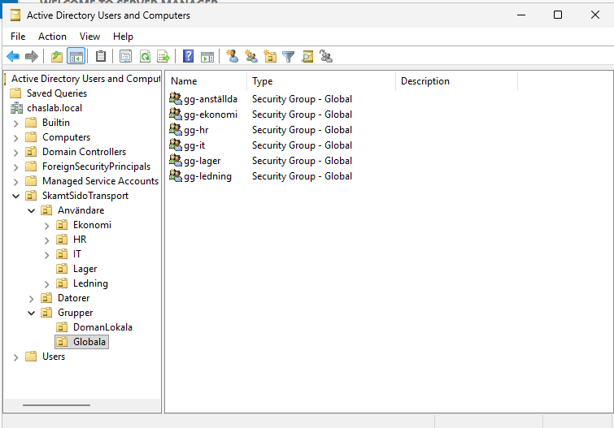
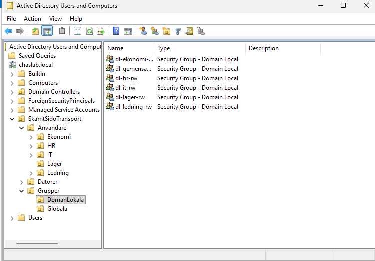
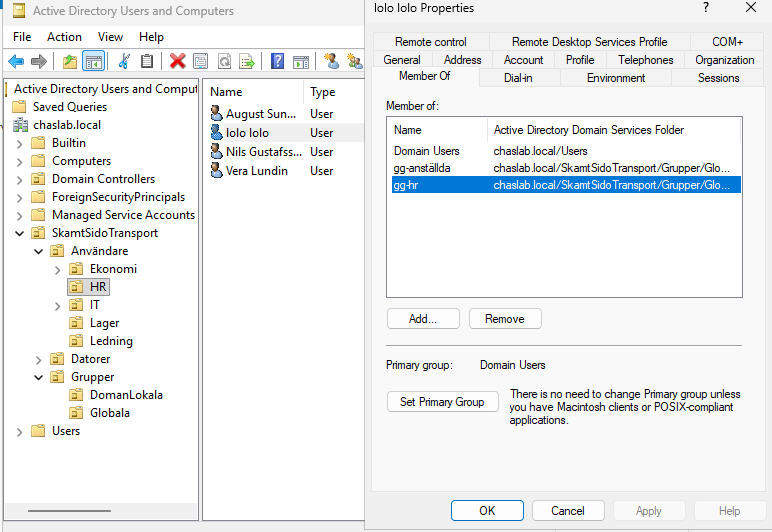
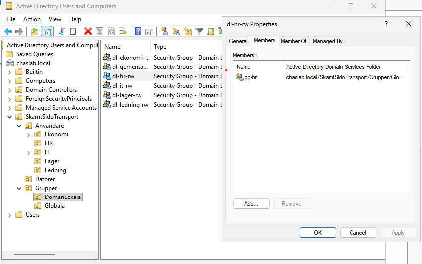
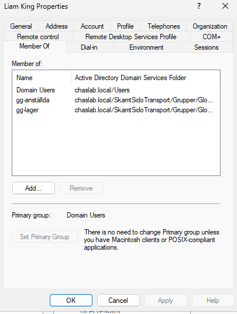

# Active Directory – Användare och säkerhetsgrupper

## Steg 1 – Öppna Active Directory

Active Directory Users and Computers (ADUC) används för att administrera användarkonton, grupper och organisationsenheter (OU).

### Genomförande

1. Öppna **Server Manager**.
2. Klicka på **Tools**.
3. Välj **Active Directory Users and Computers**.
4. Öppna domänen `sost.local`.

Här visas domänens användare, grupper och organisationsenheter.

Skärmbilderna visar hur ADUC ser ut och kan innehålla andra namn. Följ domänen `sost.local` och gruppnamnen i tabellerna när du genomför stegen.

## Steg 2 – Skapa organisationsenheter (OU)

En organisationsstruktur skapas för företaget `SkamtSidoTransport` för att hålla användare, grupper och datorer organiserade.

### Genomförande

1. Högerklicka på `sost.local`.
2. Välj **New → Organizational Unit**.
3. Ange namnet `SkamtSidoTransport`.
4. Klicka på **OK**.
5. Högerklicka på `SkamtSidoTransport`.
6. Skapa var och en av följande OU:er via **New → Organizational Unit** på `SkamtSidoTransport`:
   - `Användare`
   - `Grupper`
   - `Datorer`
7. Högerklicka på `Användare` och välj **New → Organizational Unit** för var och en av följande OU:er:
   - `HR`
   - `Ledning`
   - `Ekonomi`
   - `Lager`
   - `IT`
8. Högerklicka på `Grupper` och välj **New → Organizational Unit** för var och en av följande OU:er:
   - `Globala`
   - `DomanLokala`

### OU-struktur

Strukturen gör det enklare att hitta och administrera användarkonton och säkerhetsgrupper.

## Steg 3 – Skapa användarkonton

Testanvändare skapas för företagets olika avdelningar.

### Genomförande

1. Öppna **Active Directory Users and Computers**.
2. Gå till `SkamtSidoTransport → Användare`.
3. Öppna exempelvis OU:n `HR`.
4. Högerklicka och välj **New → User**.
5. Ange användarens förnamn och efternamn.
6. Kontrollera **Full name** och ange användarnamnet i **User logon name**.
7. Klicka på **Next**.
8. Ange ett lösenord som följer [lösenordspolicyn](losenordspolicy.md) i **Password** och upprepa det i **Confirm password**. Välj lämpliga lösenordsinställningar för testkontot.
9. Klicka på **Next → Finish**.
10. Upprepa för resterande avdelningar.

Varje användarkonto placeras i den OU som motsvarar användarens avdelning.

## Steg 4 – Globala och domänlokala säkerhetsgrupper

Vi använder säkerhetsgrupper med två olika gruppomfattningar, **Global** och **Domain local**. Det skiljer användarnas avdelningstillhörighet från behörighetshanteringen.

Egna AD-säkerhetsgrupper namnges utan `å`, `ä` och `ö`. Använd samma gruppnamn i [dokumentationen för minsta rättighet](least-privilege.md).

### Globala grupper (GG)

Globala grupper används för att samla användare som arbetar på samma avdelning.

Exempel:

- `gg-hr` – HR-personal
- `gg-ledning` – Ledningspersonal
- `gg-ekonomi` – Ekonomipersonal
- `gg-lager` – Lagerpersonal
- `gg-it` – IT-personal
- `gg-anstallda` – Samtliga anställda

Prefixet `gg-` används för att visa att gruppen är global.

### Domänlokala grupper (DL)

Domänlokala grupper används för att samla globala grupper inför tilldelning av behörigheter till resurser.

Exempel:

- `dl-hr-rw`
- `dl-ledning-rw`
- `dl-ekonomi-rw`
- `dl-lager-rw`
- `dl-it-rw`
- `dl-gemensamt-ro`

Prefixet `dl-` används för domänlokala grupper.

Förkortningarna betyder:

- `rw` = Read/Write
- `ro` = Read Only

## Steg 5 – Skapa globala säkerhetsgrupper

### Genomförande

1. Öppna **Active Directory Users and Computers**.
2. Gå till `SkamtSidoTransport → Grupper → Globala`.
3. Högerklicka i den högra panelen.
4. Välj **New → Group**.
5. Ange gruppnamnet `gg-hr`.
6. Under **Group scope**, välj **Global**.
7. Under **Group type**, välj **Security**.
8. Klicka på **OK**.
9. Upprepa för resterande grupper.

### Skapade grupper

| Grupp | Avdelning |
|---|---|
| `gg-hr` | HR |
| `gg-ledning` | Ledning |
| `gg-ekonomi` | Ekonomi |
| `gg-lager` | Lager |
| `gg-it` | IT |
| `gg-anstallda` | Alla anställda |

`gg-anstallda` används för att samla användare från samtliga avdelningar.

## Steg 6 – Skapa domänlokala säkerhetsgrupper

### Genomförande

1. Öppna **Active Directory Users and Computers**.
2. Gå till `SkamtSidoTransport → Grupper → DomanLokala`.
3. Högerklicka i den högra panelen.
4. Välj **New → Group**.
5. Ange gruppnamnet `dl-hr-rw`.
6. Under **Group scope**, välj **Domain local**.
7. Under **Group type**, välj **Security**.
8. Klicka på **OK**.
9. Upprepa för resterande grupper.

### Skapade grupper

| Grupp | Avsedd användning |
|---|---|
| `dl-hr-rw` | Läs- och skrivbehörighet för HR |
| `dl-ledning-rw` | Läs- och skrivbehörighet för Ledning |
| `dl-ekonomi-rw` | Läs- och skrivbehörighet för Ekonomi |
| `dl-lager-rw` | Läs- och skrivbehörighet till mappen Lager |
| `dl-it-rw` | Läs- och skrivbehörighet för IT |
| `dl-gemensamt-ro` | Läsbehörighet för Gemensamt |

## Steg 7 – Lägg till användare i globala grupper

Efter att säkerhetsgrupperna har skapats läggs användarna till i rätt global grupp.

### Genomförande

1. Öppna **Active Directory Users and Computers**.
2. Gå till exempelvis `Användare → HR`.
3. Högerklicka på HR-användaren.
4. Välj **Properties**.
5. Öppna fliken **Member Of**.
6. Klicka på **Add**.
7. Ange gruppnamnet `gg-hr`.
8. Klicka på **Check Names → OK**.
9. Klicka på **Add** igen, ange `gg-anstallda` och klicka på **Check Names → OK**.
10. Klicka på **Apply → OK**.

Samma steg upprepas för resterande avdelningar med motsvarande globala grupp.

Detta gör det enklare att administrera användarnas grupptillhörighet.

## Steg 8 – Koppla globala och domänlokala grupper

### Genomförande

1. Öppna **Active Directory Users and Computers**.
2. Gå till `SkamtSidoTransport → Grupper → DomanLokala`.
3. Dubbelklicka på `dl-hr-rw`.
4. Öppna fliken **Members**.
5. Klicka på **Add**.
6. Ange `gg-hr`.
7. Klicka på **Check Names → OK**.
8. Klicka på **Apply → OK**.
9. Upprepa punkterna 3–8 för de övriga domänlokala grupperna enligt tabellen [Gruppkopplingar](#gruppkopplingar). Om en domänlokal grupp har flera globala grupper, lägg till var och en via **Add** innan du klickar på **Apply → OK**.

### Gruppkopplingar

| Domänlokal grupp | Globala grupper |
|---|---|
| `dl-hr-rw` | `gg-hr` |
| `dl-ledning-rw` | `gg-ledning` |
| `dl-ekonomi-rw` | `gg-ekonomi` |
| `dl-lager-rw` | `gg-lager`, `gg-ekonomi` |
| `dl-it-rw` | `gg-it` |
| `dl-gemensamt-ro` | `gg-anstallda` |

Enligt vår [ACL-plan](acl/acc-plan.md).

## Steg 9 – Kontrollera användare och grupper

### Genomförande

1. Öppna Active Directory Users and Computers.
2. Gå till `sost.local → SkamtSidoTransport → Användare → <avdelning>` och kontrollera att användarkontona finns i rätt OU.
3. Högerklicka på en användare och välj **Properties**.
4. Öppna fliken **Member Of**.
5. Kontrollera att användaren tillhör rätt global grupp och `gg-anstallda`.

   

6. Gå till `SkamtSidoTransport → Grupper → DomanLokala`.
7. Öppna exempelvis `dl-lager-rw`.
8. Klicka på **Members**.
9. Kontrollera att både `gg-lager` och `gg-ekonomi` finns med enligt ACL-planen.

## Resultat

När guiden är genomförd ska följande stämma.

- En OU-struktur för företagets avdelningar.
- Testanvändare placerade i rätt OU.
- Sex globala säkerhetsgrupper.
- Sex domänlokala säkerhetsgrupper.
- Användare tilldelade rätt globala grupper.
- Globala grupper kopplade till motsvarande domänlokala grupper.
- Kontroll av användarnas och gruppernas medlemskap.