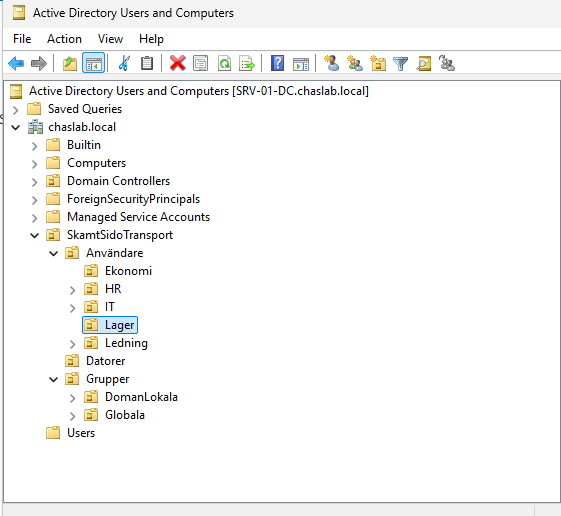
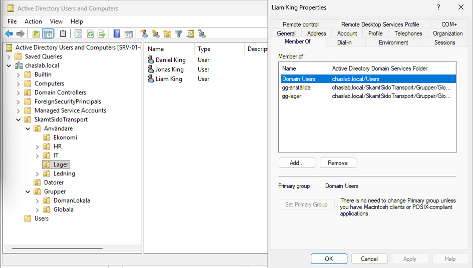

# Active Directory – Användare och säkerhetsgrupper

## Steg 1 – Öppna Active Directory

Active Directory Users and Computers (ADUC) används för att administrera användarkonton, säkerhetsgrupper och organisationsenheter (OU).

### Genomförande

1. Öppna **Server Manager**.
2. Klicka på **Tools**.
3. Välj **Active Directory Users and Computers**.
4. Öppna domänen `chaslab.local`.

Här visas domänens användare, grupper och organisationsenheter.

## Steg 2 – Skapa organisationsenheter (OU)

En organisationsstruktur skapades för företaget `SkamtSidoTransport`, där varje avdelning fick en egen OU.

### Genomförande

1. Högerklicka på `SkamtSidoTransport`.
2. Välj **New → Organizational Unit**.
3. Ange namnet på avdelningen.
4. Klicka på **OK**.
5. Upprepa stegen för resterande avdelningar.

### Skapade avdelningar

- Ekonomi
- HR
- IT
- Lager
- Ledning

Organisationsenheterna gör det enklare att strukturera och administrera användarkonton i Active Directory.

## Steg 3 – Skapa användarkonton

Tre användarkonton skapades i varje avdelning, totalt **15 användare**.

### Genomförande

1. Högerklicka på en OU, exempelvis **Ekonomi**.
2. Välj **New → User**.
3. Ange användarens förnamn och efternamn.
4. Ange ett användarnamn för inloggning.
5. Klicka på **Next**.
6. Ange ett lösenord och välj lämpliga lösenordsinställningar.
7. Klicka på **Next → Finish**.
8. Upprepa processen för resterande avdelningar.

Varje användarkonto placeras i den OU som motsvarar användarens avdelning.

## Steg 4 – Lägg till användare i säkerhetsgrupper

Efter att användarkontona skapats lades användarna till i respektive säkerhetsgrupp.

Säkerhetsgrupper används för att hantera behörigheter och åtkomst till exempelvis delade mappar och andra nätverksresurser.

### Genomförande

1. Öppna den OU där användarna finns.
2. Markera användarna som ska tillhöra samma grupp.
3. Högerklicka och välj **Add to a group**.
4. Ange namnet på säkerhetsgruppen.
5. Klicka på **Check Names** för att kontrollera gruppnamnet.
6. Klicka på **OK**.
7. Upprepa processen för resterande avdelningar.

På detta sätt kan flera användare läggas till i samma säkerhetsgrupp samtidigt.

## Steg 5 – Kontrollera användare och grupper

Efter konfigureringen kontrollerades användarkontonas placering och grupptillhörighet.

### Genomförande

1. Öppna respektive OU i Active Directory.
2. Kontrollera att användarkontona finns i rätt avdelning.
3. Högerklicka på en användare och välj **Properties**.
4. Öppna fliken **Member Of**.
5. Kontrollera att användaren tillhör rätt säkerhetsgrupp.

## Resultat

Följande har genomförts:

- Fem organisationsenheter för olika avdelningar.
- Tre användarkonton per avdelning.
- Totalt 15 användarkonton.
- Placering av användarna i rätt OU.
- Tilldelning av säkerhetsgrupper.
- Kontroll av användarnas grupptillhörighet.
