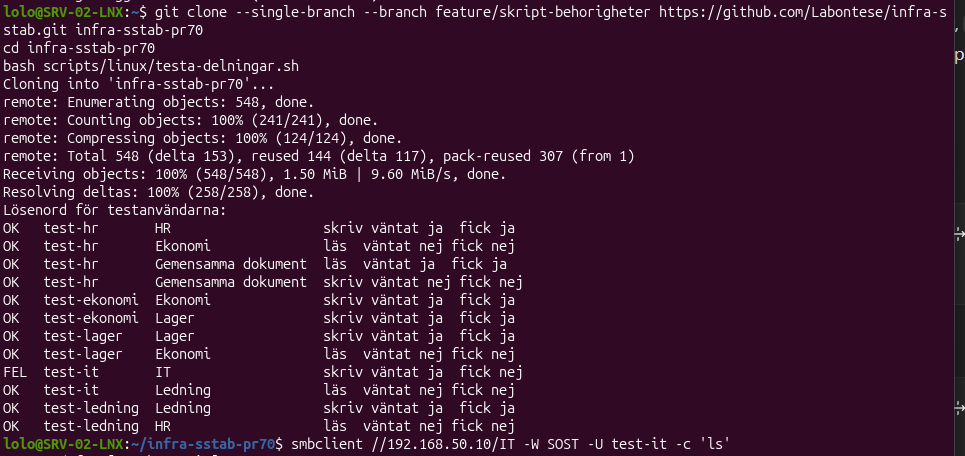
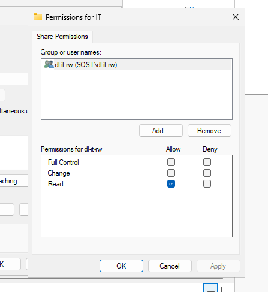
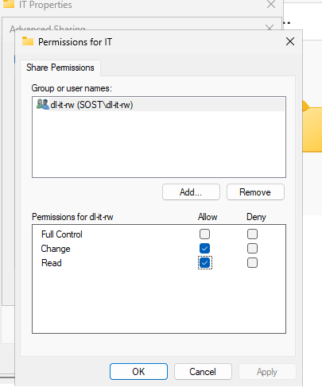
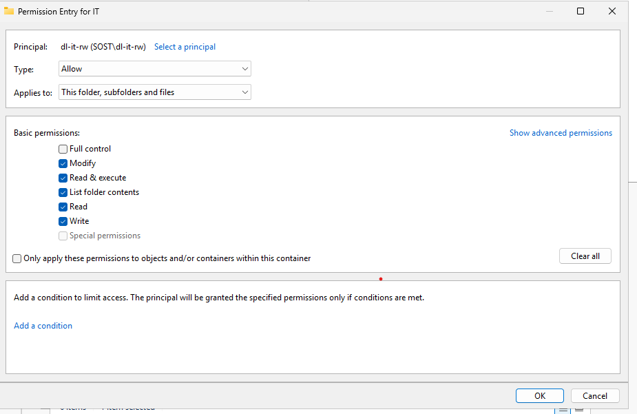

# Felsökningslogg

Logg över verkliga problem som teamet stött på under installation, konfiguration och drift (kursmål 7). Varje post beskriver problemet och åtgärden med systematisk felsökningsmetodik.

## Mall för nya poster

```markdown
### Kort rubrik för problemet

1. **Symptom:** Felmeddelande eller felaktigt beteende som upptäcktes.
2. **Hypotes:** Vad antogs vara orsaken till felet?
3. **Felsökningssteg / Test:** Kommandon och verktyg som användes för att testa hypotesen.
4. **Grundorsak:** Den faktiska orsaken bakom felet.
5. **Åtgärd:** Vad som gjordes för att lösa problemet.
6. **Verifiering:** Hur lösningen testades och bekräftades.
```

---

## Loggade incidenter

### Klient kan inte ansluta till domänen sost.local (DNS)

1. **Symptom:**
   Felmeddelande vid anslutning till domänen:
   > *"An Active Directory Domain Controller for the domain 'sost.local' could not be contacted."*

2. **Hypotes:**
   - **Hypotes 1:** Domänkontrollanten (192.168.50.10) är inte igång eller nåbar.
   - **Hypotes 2:** Klienten frågar fel DNS-server (t.ex. routern eller 8.8.8.8) som inte känner till den lokala zonen `sost.local`.

3. **Felsökningssteg / Test:**
   - **Pinga DC:**
     ```powershell
     ping 192.168.50.10
     ```
     *Resultat:* Svar erhölls. Nätverket fungerar.
   - **Kontrollera DNS:**
     ```powershell
     Get-NetIPConfiguration
     ```
     *Resultat:* DNS-servern stod på routern (`192.168.50.1`) istället för DC (`192.168.50.10`).

4. **Grundorsak:**
   Klienten saknade pekare till domänkontrollanten som primär DNS och kunde därför inte hitta `sost.local`.

5. **Åtgärd:**
   - Kontrollera nätverkskortets namn:
     ```powershell
     Get-NetAdapter
     ```
   - Sätt DNS till DC:ns IP (använd namnet från steget ovan):
     ```powershell
     Set-DnsClientServerAddress -InterfaceAlias "Ethernet" -ServerAddresses "192.168.50.10"
     ```

6. **Verifiering:**
   - Testa namnuppslagning:
     ```powershell
     Resolve-DnsName sost.local
     ```
     *Resultat:* Svarade med `192.168.50.10`.
   - Anslut klienten till domänen:
     ```powershell
     Add-Computer -DomainName "sost.local" -Credential (Get-Credential) -Restart
     ```
     *Resultat:* Datorn anslöts och startade om utan fel.


### IT-delningen nekar filskapande

**Datum** 2026-11-26

1. **Symptom** – Första körningen av `testa-delningar.sh` från `SRV-02-LNX` visade **FEL** när `test-it` försökte skriva i IT-delningen. [Testa fildelning från Linux](https://github.com/Labontese/infra-sstab/blob/12828fa132e2753d7177e4ff837e2275fa850a89/docs/how-to/test-fildelning-fran-linux.md)

   

2. **Hypotes** – Gruppen `dl-it-rw` saknade skrivrätt på SMB-delningen eller på IT-mappen.

3. **Felsökning** – Ett test med `smbclient` visade att `test-it` kunde lista filer i IT. Uppladdningen av en provfil gav `NT_STATUS_ACCESS_DENIED`. Efter att **Change** lades till på SMB-delningen nekades uppladdningen fortfarande. En kontroll med `Get-Acl` visade att gruppen bara hade **ReadAndExecute** på IT-mappen.

4. **Grundorsak** – `dl-it-rw` hade läsbehörighet på båda nivåerna. SMB-delningen gav **Read** och IT-mappens NTFS-behörighet gav **ReadAndExecute**.

5. **Åtgärd** – `SOST\dl-it-rw` fick **Change** på SMB-delningen och **Modify** på IT-mappen.

   **SMB-delningen före och efter**

   | Före – Read | Efter – Read och Change |
   | --- | --- |
   |  |  |

   **NTFS efter ändringen**

   **Modify** gäller för mappen, undermappar och filer. Rutan som begränsar arvet till närmaste nivå är avmarkerad.

   

6. **Verifiering** – `test-it` kunde ladda upp provfilen. När skriptet kördes igen visade alla 12 kontroller **OK**.
