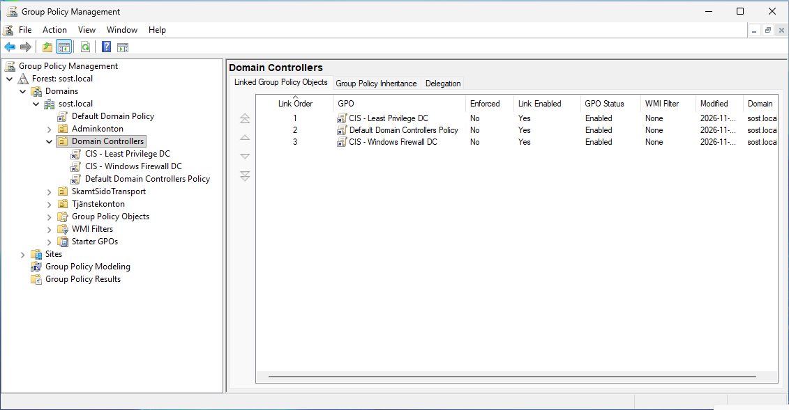
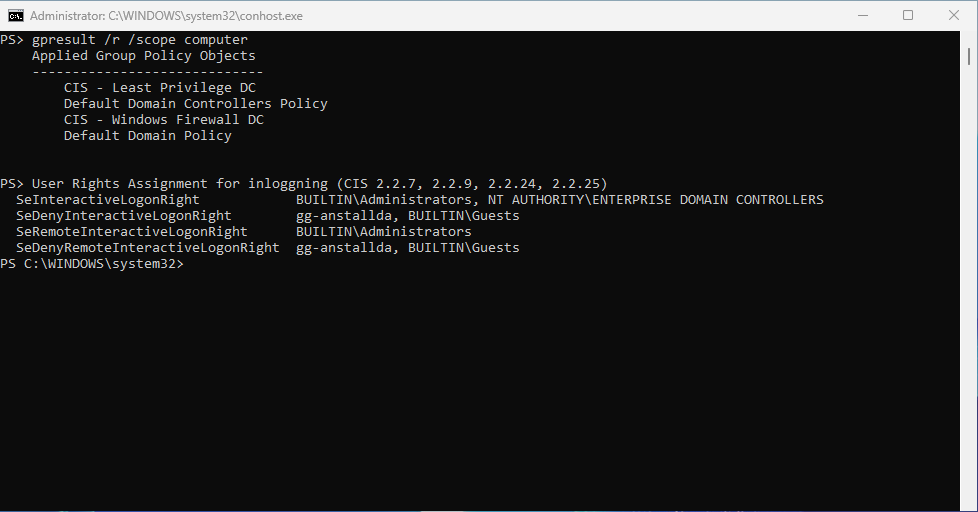
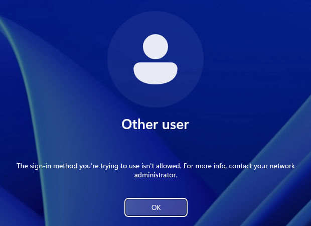

# Active Directory – Minsta rättighet (Least Privilege) enligt CIS

Principen om minsta rättighet betyder att varje användare och grupp bara har de rättigheter som krävs för arbetet. Inställningarna bygger på *CIS Microsoft Windows Server 2025 Benchmark v2.1.0*, kapitel 2.2 "User Rights Assignment" (sida 63).

Principen tillämpas på två nivåer:

- **Mappar:** vilka grupper som får läsa och skriva i vilka mappar, se [behörighetsmatrisen](acl/acc-plan.md).
- **System:** vem som får logga in på domänkontrollanten, ansluta datorer till domänen och stänga av servern. Det beskrivs på den här sidan.

Rättigheter ges alltid till grupper, aldrig till enskilda användare.

## Steg 1 – Öppna Group Policy Management

### Genomförande

1. Öppna **Server Manager**.
2. Klicka på **Tools**.
3. Välj **Group Policy Management**.
4. Gå till **Forest → Domains → sost.local → Domain Controllers**.

## Steg 2 – Skapa en GPO för domänkontrollanten

En egen GPO skapades i stället för att ändra Default Domain Controllers Policy. Då syns det tydligt vilka inställningar som kommer från CIS, och de går att ångra.

### Genomförande

1. Högerklicka på OU:n **Domain Controllers**.
2. Välj **Create a GPO in this domain, and Link it here**.
3. Ange namnet `CIS - Least Privilege DC`.
4. Klicka på **OK**.

GPO:n ska bara vara länkad till **Domain Controllers**. Länkas den till hela domänen nekas alla anställda inloggning på sina egna datorer.



## Steg 3 – Ställ in User Rights Assignment

### Genomförande

1. Högerklicka på `CIS - Least Privilege DC` och välj **Edit**.
2. Gå till **Computer Configuration → Policies → Windows Settings → Security Settings → Local Policies → User Rights Assignment**.
3. Dubbelklicka på en inställning och kryssa i **Define these policy settings**.
4. Klicka på **Add User or Group…** och ange grupperna enligt tabellen.
5. Klicka på **OK**.
6. Upprepa för resterande inställningar.

| CIS | Inställning | CIS-krav | Vårt värde |
|---|---|---|---|
| 2.2.5 | Add workstations to domain | Administrators | Administrators |
| 2.2.7 | Allow log on locally | Administrators, ENTERPRISE DOMAIN CONTROLLERS | Administrators, ENTERPRISE DOMAIN CONTROLLERS |
| 2.2.9 | Allow log on through Remote Desktop Services | Administrators | Administrators |
| 2.2.19 | Debug programs | Administrators | Administrators |
| 2.2.24 | Deny log on locally | Ska innehålla Guests | Guests, gg-anstallda |
| 2.2.25 | Deny log on through Remote Desktop Services | Ska innehålla Guests | Guests, gg-anstallda |
| 2.2.46 | Shut down the system | Administrators | Administrators |

Ta aldrig bort `Administrators` från **Allow log on locally**. Då kan ingen logga in på domänkontrollanten.

## Steg 4 – Kontrollera gruppen gg-anstallda

Gruppen `gg-anstallda` skapas och fylls med alla anställda enligt [OU.md](OU.md). Den används i Deny-reglerna i Steg 3, så att alla anställda nekas inloggning på domänkontrollanten. Ett nekande vinner alltid över ett tillstånd. Namnet skrivs utan å, ä och ö för att undvika problem med svenska tecken.

### Genomförande

1. Öppna **Active Directory Users and Computers**.
2. Högerklicka på `gg-anstallda` och välj **Properties**.
3. Öppna fliken **Members** och kontrollera att alla anställda finns med.

IT-personalen har ett separat adminkonto (`adm-<namn>`) i gruppen `Administrators`. Adminkontot får inte vara med i `gg-anstallda`, annars nekas det också inloggning. Det vanliga kontot används för det dagliga arbetet.

## Steg 5 – Delegera användarhantering till IT

Gruppen `gg-it` får hantera användarkonton i företagets OU utan att vara med i Domain Admins.

### Genomförande

1. Högerklicka på `SkamtSidoTransport` och välj **Delegate Control…**.
2. Klicka på **Next**, sedan **Add…**, ange `gg-it` och klicka på **Check Names**.
3. Klicka på **OK** och **Next**.
4. Kryssa i **Create, delete, and manage user accounts** och **Reset user passwords and force password change at next logon**.
5. Klicka på **Next → Finish**.

## Steg 6 – Tillämpa och kontrollera

### Genomförande

1. Kör i PowerShell på domänkontrollanten:
   ```powershell
   gpupdate /force
   gpresult /r /scope computer
   ```
2. Kontrollera att `CIS - Least Privilege DC` finns under **Applied Group Policy Objects**.
3. Försök logga in på domänkontrollanten med en vanlig användare, till exempel en i `gg-lager`. Inloggningen ska nekas.
4. Kontrollera att ingen vanlig användare är med i **Domain Admins** (Properties → **Members**).





## Behörighet per grupp

| Grupp | Mappar | Inloggning på DC | Ansluta datorer | Hantera användare | Lösenordspolicy |
|---|---|---|---|---|---|
| `gg-ledning` | RW Ledning, R Gemensamt | Nej | Nej | Nej | `pso-ledning` |
| `gg-hr` | RW HR, R Gemensamt | Nej | Nej | Nej | `pso-hr` |
| `gg-ekonomi` | RW Ekonomi och Lager, R Gemensamt | Nej | Nej | Nej | `pso-ekonomi` |
| `gg-it` | RW IT, R Gemensamt | Nej | Nej | Ja, delegerat på `SkamtSidoTransport` | `pso-it` |
| `gg-lager` | RW Lager, R Gemensamt | Nej | Nej | Nej | `pso-lager` |
| Adminkonton (`adm-<namn>`) | – | Ja | Ja | Ja | Default Domain Policy |

Mapparna delas från en Windows-server. Vilken server är inte bestämt än. Lösenordspolicyerna beskrivs i [losenordspolicy.md](losenordspolicy.md).

## Resultat

Följande har genomförts:

- En GPO, `CIS - Least Privilege DC`, länkad till Domain Controllers.
- Sju inställningar från CIS 2.2 User Rights Assignment.
- Bara administratörer kan logga in på domänkontrollanten, ansluta datorer till domänen och stänga av servern.
- Gruppen `gg-anstallda` med alla anställda, nekad inloggning på domänkontrollanten.
- Delegerad användarhantering till gruppen `gg-it`.
