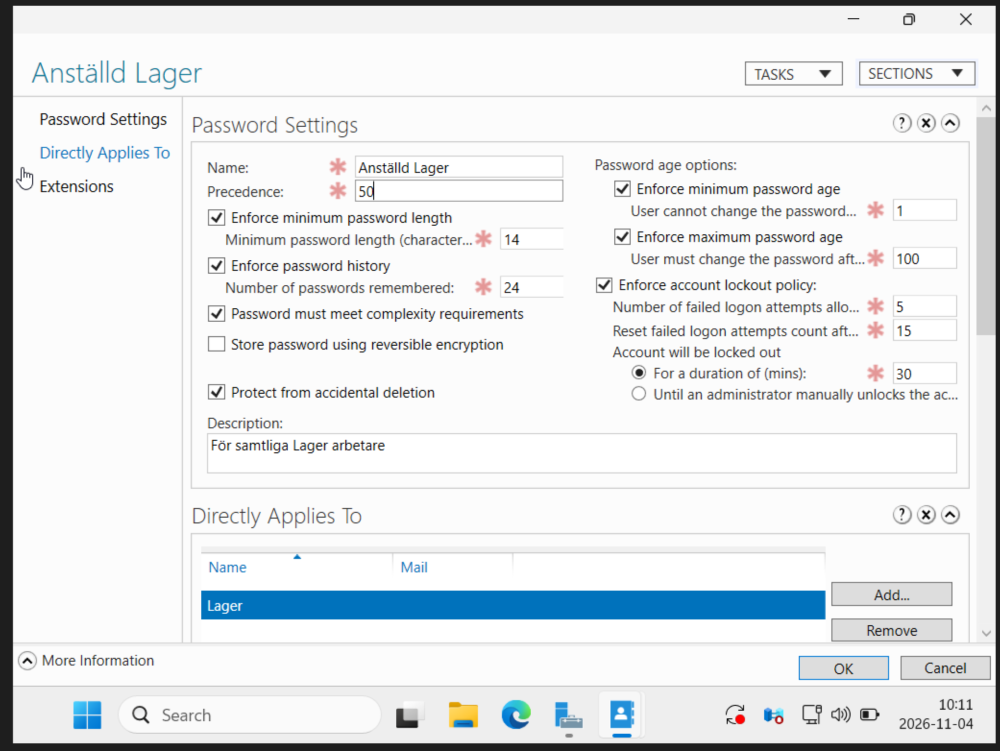

# Active Directory – Lösenords- och utlåsningspolicy (CIS)

Lösenordspolicyn bygger på *CIS Microsoft Windows Server 2025 Benchmark v2.1.0*, kapitel 1 "Account Policies" (sida 35). Policyn täcker lösenordskomplexitet, lösenordslängd, kontoutlåsning och intervall på lösenordsbyte.

## Steg 1 – Öppna Active Directory Administrative Center

Lösenordspolicyn för en avdelning skapas som ett lösenordsinställningsobjekt (Password Settings Object, PSO) i Active Directory Administrative Center (ADAC).

### Genomförande

1. Öppna **Server Manager**.
2. Klicka på **Tools**.
3. Välj **Active Directory Administrative Center**.
4. Gå till **sost (local) → System → Password Settings Container**.

## Steg 2 – Skapa lösenordsinställningar

En PSO skapades för lagerpersonalen.

### Genomförande

1. Högerklicka på **Password Settings Container**.
2. Välj **New → Password Settings**.
3. Ange namn `pso-lager` och precedence enligt [Precedence per avdelning](#precedence-per-avdelning).
4. Ange värdena enligt tabellerna nedan.
5. Kryssa i **Protect from accidental deletion**.
6. Ange beskrivningen `För samtliga Lager arbetare`.

### Password Policy

| CIS | Inställning | CIS-krav | pso-lager / Default Domain Policy |
|---|---|---|---|
| 1.1.1 | Enforce password history | 24 eller fler | 24 |
| 1.1.2 | Maximum password age | 365 dagar eller färre, inte 0 | 100 dagar |
| 1.1.3 | Minimum password age | 1 dag eller mer | 1 dag |
| 1.1.4 | Minimum password length | 14 tecken eller fler | 14 |
| 1.1.5 | Password must meet complexity requirements | Enabled | På |
| 1.1.7 | Store passwords using reversible encryption | Disabled | Av |

### Account Lockout Policy

| CIS | Inställning | CIS-krav | pso-lager / Default Domain Policy |
|---|---|---|---|
| 1.2.1 | Account lockout duration | 15 minuter eller mer | 30 minuter |
| 1.2.2 | Account lockout threshold | 5 försök eller färre, inte 0 | 5 |
| 1.2.4 | Reset account lockout counter after | 15 minuter eller mer | 15 minuter |

CIS 1.1.6 och 1.2.3 gäller bara medlemsservrar och finns inte i en PSO.

## Steg 3 – Koppla policyn till säkerhetsgruppen

PSO:n kopplades till säkerhetsgruppen `Lager`, så att den gäller alla användare i gruppen.

### Genomförande

1. Gå till **Directly Applies To** i samma fönster.
2. Klicka på **Add…**.
3. Ange gruppen `Lager` och klicka på **Check Names**.
4. Klicka på **OK**.
5. Klicka på **OK** för att spara PSO:n.
6. Upprepa steg 2–3 för resterande avdelningar: Ekonomi, HR, IT och Ledning.

Varje avdelning får en egen PSO med eget namn, exempelvis `pso-ekonomi`, och kopplas till avdelningens säkerhetsgrupp. Precedence-värdet för varje PSO står i [Precedence per avdelning](#precedence-per-avdelning).

En PSO kan bara kopplas till användare och globala säkerhetsgrupper, inte till OU:er.



## Precedence per avdelning

| Avdelning | PSO | Säkerhetsgrupp | Precedence |
|---|---|---|---|
| Ledning | `pso-ledning` | Ledning | 10 |
| IT |  `pso-it` | IT | 20 |
| Ekonomi |  `pso-ekonomi` | Ekonomi | 30 |
| HR |  `pso-hr` | HR | 40 |
| Lager |  `pso-lager` | Lager | 50 |

Lägst siffra vinner, och den striktaste policyn ska ha lägst värde. Luckorna gör att nya PSO:er kan läggas in utan att de andra behöver numreras om.

Så väljer AD vilken PSO som gäller för en användare:

- En PSO kopplad direkt till användaren går före gruppernas PSO:er.
- Bland gruppernas PSO:er vinner den med lägst precedence.
- Två PSO:er med samma värde avgörs av objektets GUID, vilket inte går att förutsäga. Därför har varje PSO ett eget värde.
- Om ingen PSO träffar gäller Default Domain Policy.

Precedence på en befintlig PSO ändras i ADAC (dubbelklicka på PSO:n i **Password Settings Container**) eller i PowerShell:

```powershell
Set-ADFineGrainedPasswordPolicy -Identity "pso-lager" -Precedence 50
```

## Steg 4 – Kontrollera policyn

Kontrollera i PowerShell att PSO:n finns och att den gäller för en användare i lagret.

### Genomförande

1. Öppna **PowerShell** som administratör.
2. Lista alla PSO:er:
   ```powershell
   Get-ADFineGrainedPasswordPolicy -Filter *
   ```
3. Kontrollera vilken policy som gäller för en användare:
   ```powershell
   Get-ADUserResultantPasswordPolicy -Identity <användare>
   ```

Kommandot i punkt 3 ska returnera `pso-lager` för en användare i gruppen `Lager`. Om det inte returnerar något gäller domänens standardpolicy (Default Domain Policy).

## Steg 5 – Byta avdelning för en användare

PSO:n följer gruppmedlemskapet. När en användare byter avdelning byts gruppen, inte PSO:n.

### Genomförande

1. Högerklicka på användaren och välj **Properties**.
2. Öppna fliken **Member Of**, markera den gamla säkerhetsgruppen och klicka på **Remove**.
3. Klicka på **Add…**, ange den nya gruppen och klicka på **Check Names**.
4. Klicka på **OK**.
5. Flytta användarkontot till den nya avdelningens OU. Det påverkar inte PSO:n, men håller strukturen från [OU.md](OU.md).
6. Kontrollera att rätt PSO gäller:
   ```powershell
   Get-ADUserResultantPasswordPolicy -Identity <användare>
   ```

Utlåsning och maxålder på lösenordet gäller direkt. Längd och komplexitet kontrolleras först vid nästa lösenordsbyte. Om användaren tillfälligt finns i båda grupperna gäller PSO:n med lägst precedence.

## Steg 6 – Domänens standardpolicy (Default Domain Policy)

Default Domain Policy gäller alla konton som inte omfattas av en PSO, till exempel adminkonton. PSO:erna är undantag per avdelning. CIS anger att inställningarna i 1.1 och 1.2 ska sättas här för att gälla domänkontona.

### Genomförande

1. Öppna **Server Manager**.
2. Klicka på **Tools**.
3. Välj **Group Policy Management**.
4. Gå till **Forest → Domains → sost.local**.
5. Högerklicka på **Default Domain Policy** och välj **Edit**.
6. Gå till **Computer Configuration → Policies → Windows Settings → Security Settings → Account Policies**.
7. Ange värdena under **Password Policy** och **Account Lockout Policy** enligt tabellerna i Steg 2.
8. Kör `gpupdate /force` i PowerShell.
9. Kontrollera att värdena gäller:
   ```powershell
   Get-ADDefaultDomainPasswordPolicy
   ```

## Resultat

Följande har genomförts:

- En PSO, `pso-lager`, med precedence enligt [Precedence per avdelning](#precedence-per-avdelning).
- Lösenordskomplexitet påslagen (CIS 1.1.5).
- Minsta lösenordslängd 14 tecken (CIS 1.1.4).
- Kontoutlåsning efter 5 misslyckade försök i 30 minuter (CIS 1.2.1, 1.2.2, 1.2.4).
- Lösenordsbyte tidigast efter 1 dag och senast efter 100 dagar, och de 24 senaste lösenorden får inte återanvändas (CIS 1.1.1–1.1.3).
- Koppling av PSO:n till säkerhetsgruppen `Lager`.
- Default Domain Policy med CIS 1.1 och 1.2.
