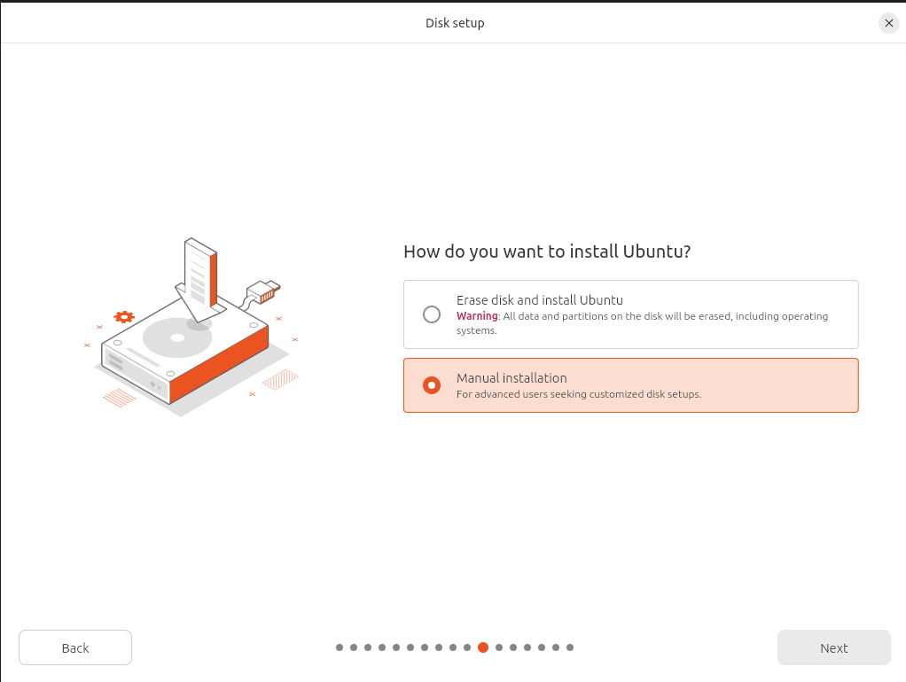
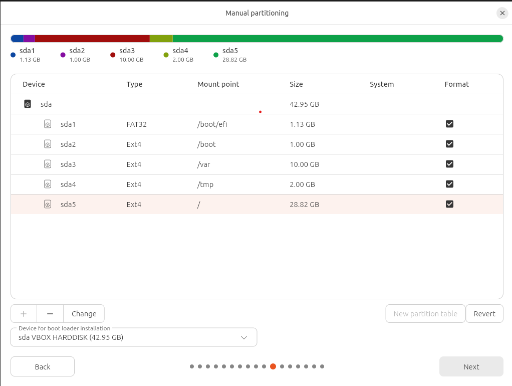
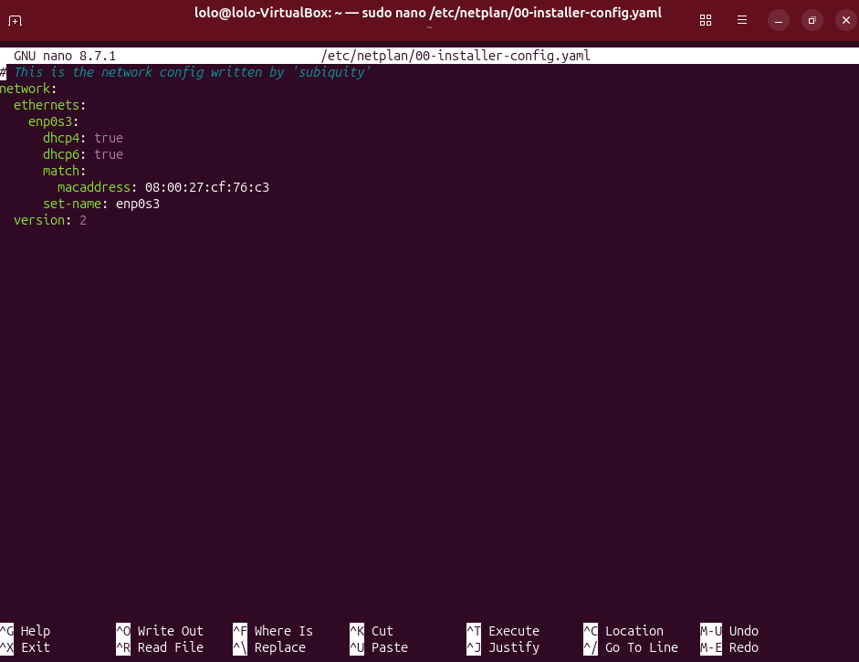

# Tutorial: Skapa din första Ubuntu-Server

En tutorial tar en nybörjare i handen och lär genom att göra – inte genom att förklara allt i förväg. Läsaren ska kunna följa stegen utan att redan förstå varför, och lyckas varje gång.

**Mål:** Att installera en fungerande Ubuntu-Server och starta enheten till OS.

**Förutsättningar:** Nedladdad version av Ubuntu-Desktop 26.04.1 ISO-fil på USB-minne eller i en Virtuell miljö.
1. Starta installation Ubuntu med hjälp av USB-minne eller VM-maskin.<br><br>
2. Följ installations-guiden som startar vid första boot.<br><br>
3. Välj egna preferenser i installationsguiden till du når sidan med "How do you want to install Ubuntu?"<br><br>
4.  Konfigurera partitionen enligt följande:
Se även färdigställd bild under tabell.  

| Mount | Storlek | Format | Innehåll |
| --- | --- | --- | --- |
| /boot/efi | Automatisk (skapas automatiskt) | fat32/vfat | UEFI/EFI-bootloader |
| /boot | 1 GB | ext4 | Linux-kärnor, gamla kärnor för backup |
| /var | 10 GB | ext4 | Systemloggar, APT-paketcache, Flatpak/Snap-data, Docker-images |
| /tmp | 2 GB | ext4 | — |
| / | Resten av disken (lämna tomt eller ange max) | ext4 | Systembinärer, GNOME-skrivbordsmiljö, standardappar, /home-användarfiler |  



5. Fortsätt klicka Nästa/Next och välj egna preferenser till dina användaruppgifter samt lösenord.

**Installationen är nu lyckad, nästa steg är IP-inställningar:**

Om du använder Virtuell Maskin behövs dessa inställningar skapas innan nästa steg nedertill:
Skapa ett NATNetwork, eller välj ditt befintliga NATNetwork för din nätverksadapter i din VM.
Network > NAT Networks > Create > fyll i IP 192.168.50.0/24

Högerklicka på Settings på din VM > Network > Välj NAT Network på adapter 1.

IP-sättnning med statisk IP-address:
1. Starta Terminal i Ubuntu och öppna följande konfigurerings-fil: 
```
sudo nano /etc/netplan/00-installer-config.yaml
```

2. Kopiera följande värden i din yaml-fil:
```
# This is the network config written by 'subiquity'
network:
  version: 2
  ethernets:
    enp0s3:
      dhcp4: false
      dhcp6: true
      addresses:
        - 192.168.50.50/24
      routes:
        - to: default
          via: 192.168.50.1
      nameservers:
        addresses:
          - 8.8.8.8
      match:
        macaddress: <förändra ej MAC-adress, den är personlig>
      set-name: enp0s3
```


Använda dig av TAB endast istället för mellanslag i filen. 

3. Spara genom Ctrl + X, sedan Y och sen Enter för att spara.  

4. Skriv sedan "sudo netplan generate" och därefter "sudo netplan try" för att aktivera inställningarna för statisk IP-adress.

5. För att se att interface är funktionellt efter IP-sättningen i netplan:  
```ip -br addr```

6. För att se att den fullständiga IP-adressen är korrekt  
```ip a```  
Resultatet ska visa ip ```192.168.50.50/24```

---

# Installera nginx HTTP server

### Installation


För att installera nginx, ange följande kommando i terminal:  
```sudo apt update && sudo apt install nginx```

Starta nginx: ```sudo systemctl start nginx```  
Starta nginx automatiskt vid boot: ```sudo systemctl enable nginx```  

Starta om nginx genom  
```sudo systemctl restart nginx```

Ladda om nginx konfigurationsfiler  
```sudo systemctl reload nginx```

Verifiera att nginx körs och är aktiv   
```sudo systemctl status nginx```

---
### Verifiering
Öppna en webläsare på Ubuntu och verifiera nåbarhet på adressen:  
```http://localhost``` eller ```http://192.168.50.50```

### Felsökningssteg
Brandvägg: Förhindras sidan att visas, prova att tillåta trafik igenom brandväggen:  

Öppnar port 80 (HTTP)  
```sudo ufw allow 'Nginx HTTP'```  

Öppnar port 80 (HTTP) och 443 (HTTPS), behövs bara om HTTPS ska sättas upp.   
```sudo ufw allow 'Nginx Full'``` 

---
### Kataloger och loggar
```/var/www/html``` Hemkatalog för webbplatsens filer  
```/etc/nginx/``` Nginx-konfiguration  
```/var/log/nginx/access.log``` Loggar för trafik  
```/var/log/nginx/error.log``` Felmeddelanden och felsökningsinformation  